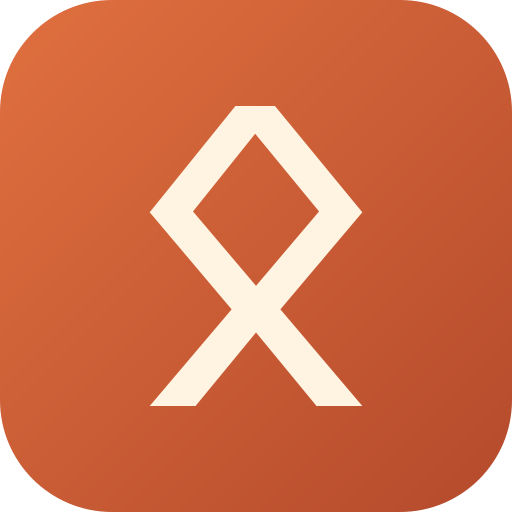

<p align="center"></p>

# Bitig

**English** · [Türkçe](#türkçe)

*Bitig* means "inscription, book" in Old Turkic. The logo is the Old Turkic (Orkhon) letter 𐰋, the first letter of the word.

> A personal project: I built it for my own studying and keep using and improving it. It is not a product or a hosted service; the code is shared openly in case it is useful to someone else.

A study notebook for questions and answers you collect from AI chats (ChatGPT, Claude, Gemini, Antigravity…). When one assistant hits its limit and you continue in another, your notes end up scattered across tools. Bitig keeps them in one place, organized by course and section, next to the PDF you are studying.

> The user interface is in **Turkish**.

Everything runs in your browser. There is no server and no account: your notes are stored locally (IndexedDB) and never leave your computer.

## Features

- **Courses → sections → sub-sections**, nested as deep as you like; reorder and move them by drag and drop.
- **Chat-style Q&A cards**: only questions are shown, click one to reveal the answer. Markdown, tables, syntax-highlighted code and LaTeX formulas (`$…$`, `$$…$$`, `\(…\)`, `\[…\]`) are rendered.
- **Smart paste**: pasting from an AI chat keeps code blocks, tables and formulas.
- **Paste a whole chat**: it is split into question–answer pairs automatically (ChatGPT, Claude, Gemini and Antigravity formats are recognized), with a preview to fix things before saving. Unrecognized text can be split by clicking.
- **PDF per section**: the page you are reading on the left, that page's questions on the right. Highlight, draw, add sticky notes, erase.
- **Ask AI from the PDF**: select text and send it to ChatGPT / Claude / Gemini, or snip a region of a page and attach it as an image to a question. One button copies the question and the image together, ready to paste into a chat.
- **Got it / Review again** marks, with filters and per-section counts.
- **Study mode**: questions one at a time with hidden answers; "I knew it / I didn't" updates the marks, and you can retry the missed ones.
- **Search** across sections, questions, answers and notes (Ctrl+K).
- **Export** a section or a whole course to **PDF** (via the print dialog) or **Word (.docx)** with native, editable equations. Optionally questions only, as a worksheet.
- **Backup / restore** as a JSON file (optionally including the PDFs).
- Installable as a **PWA**, works offline, updates itself; light and dark themes.

## Getting started

Requirements: [Node.js](https://nodejs.org) 18 or newer.

```bash
git clone https://github.com/erenahmet17/ders-defteri.git
cd ders-defteri
npm install
npm run dev
```

Then open http://localhost:5173. On Windows you can also double-click `baslat.bat`.

### Hosting your own copy

```bash
npm run build
```

This produces a static site in `dist/` that can be served from any static host (Vercel, Netlify, GitHub Pages, Cloudflare Pages…). Installing it as an app (PWA) requires HTTPS, which those hosts provide.

## Your data

Notes live in the browser you use them in. A different browser, a private window or clearing site data means a different, empty notebook. Use **Yedek al** (Back up) at the bottom left now and then, and **Geri yükle** (Restore) to move your notes to another computer.

## Tech stack

React 18 · Vite · Dexie (IndexedDB) · react-markdown + KaTeX + highlight.js · pdf.js · docx · vite-plugin-pwa · lucide icons

## Contributing

This is a personal project, so there is no roadmap or support promise. Issues, ideas and pull requests are still welcome; for larger changes, please open an issue first.

## License

[MIT](LICENSE) © 2026 Ahmet Eren Tutuş

The logo's letter shape comes from [Noto Sans Old Turkic](https://github.com/notofonts/old-turkic) (SIL Open Font License 1.1).

---

## Türkçe

*Bitig*, Eski Türkçede "yazıt, kitap" demek. Logodaki işaret, kelimenin ilk harfi olan Göktürk (Orhun) harfi 𐰋.

> Kişisel bir proje: kendi ders çalışmam için yaptım, kullanmaya ve geliştirmeye devam ediyorum. Bir ürün ya da hizmet değil; başkasının da işine yarayabilir diye kodu açık paylaşıyorum.

Yapay zekâ sohbetlerinden (ChatGPT, Claude, Gemini, Antigravity…) çıkan soru-cevaplar için bir çalışma defteri. Bir asistanın limiti dolup başka birinde devam edince notlar farklı yerlere dağılıyor. Bitig hepsini ders ve bölüm bazında, çalıştığın PDF'in yanında tek bir yerde topluyor.

Her şey tarayıcında çalışır. Sunucu da hesap da yoktur: notların bilgisayarında (IndexedDB) saklanır, hiçbir yere gönderilmez.

### Özellikler

- **Ders → bölüm → alt bölüm**, istediğin kadar iç içe; sürükle-bırak ile sırala ve taşı.
- **Sohbet gibi soru-cevap kartları**: sadece sorular görünür, tıklayınca cevap açılır. Markdown, tablo, renkli kod ve LaTeX formüller desteklenir.
- **Akıllı yapıştırma**: yapay zekâ sohbetinden yapıştırınca kod blokları, tablolar ve formüller korunur.
- **Sohbetin tamamını yapıştırma**: soru-cevaplara otomatik ayrılır (ChatGPT, Claude, Gemini ve Antigravity biçimleri tanınır); kaydetmeden önce önizlemede düzeltebilirsin. Tanınmayan metin tıklayarak ayrılabilir.
- **Her bölüme bir PDF**: solda okuduğun sayfa, sağda o sayfanın soruları. Vurgulama, kalem, yapışkan not, silgi.
- **PDF'ten yapay zekâya sorma**: metni seçip ChatGPT / Claude / Gemini'ye gönder ya da sayfadan bir alan seçip soruya görsel olarak ekle. Tek tuşla soru ve görsel birlikte kopyalanır.
- **Anladım / Tekrar bak** işaretleri, filtreler ve bölüm bazında sayılar.
- **Çalışma modu**: sorular tek tek ve cevap gizli gelir; "Bildim / Bilemedim" işaretleri günceller, bilemediklerini tekrar çalışabilirsin.
- **Arama** (Ctrl+K): bölümler, sorular, cevaplar ve notlar.
- **Dışa aktarma**: bir bölümü ya da bütün dersi **PDF** (yazdırma penceresiyle) veya düzenlenebilir denklemli **Word (.docx)** olarak indir. İstersen sadece sorular (çalışma kâğıdı).
- **Yedek alma / geri yükleme** (JSON dosyası, istersen PDF'lerle birlikte).
- **PWA** olarak kurulabilir, çevrimdışı çalışır, kendini günceller; açık ve koyu tema.

### Çalıştırma

[Node.js](https://nodejs.org) 18 veya üstü gerekir.

```bash
git clone https://github.com/erenahmet17/ders-defteri.git
cd ders-defteri
npm install
npm run dev
```

Ardından http://localhost:5173 adresini aç. Windows'ta `baslat.bat` dosyasına çift tıklaman da yeterli.

Kendi sunucunda yayınlamak için `npm run build` çalıştır. Çıkan `dist/` klasörü herhangi bir statik barındırma hizmetinde (Vercel, Netlify, GitHub Pages…) çalışır. Uygulama olarak kurmak (PWA) için HTTPS gerekir.

### Verilerin

Notlar, kullandığın tarayıcının içinde durur. Başka bir tarayıcı, gizli pencere ya da site verilerini temizlemek boş bir defter demektir. Sol alttaki **Yedek al** ile ara sıra yedek al; başka bilgisayara geçerken **Geri yükle** ile aktar.

### Katkı

Kişisel bir proje olduğu için bir yol haritası ya da destek sözü yok; yine de issue, öneri ve pull request'ler açık.

### Lisans

[MIT](LICENSE) © 2026 Ahmet Eren Tutuş

Logodaki harf şekli [Noto Sans Old Turkic](https://github.com/notofonts/old-turkic) fontundan alınmıştır (SIL Open Font License 1.1).
